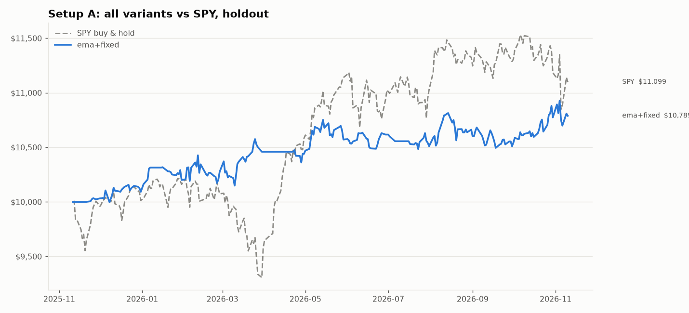

# Backtest results: holdout (2025-11-11 to 2026-11-10)

Starting equity $10,000; risk 0.75%/trade, max 15% per position, max 5 positions (2 per sector), 2% daily loss limit; whole shares; 5 bps slippage per fill; $0 commission.

## 1. Signal level (every filled signal, no portfolio limits)

This is the cleanest test of whether the setup has an edge, because it isn't affected by account size or which signals happened to overlap. `se` = standard error of the mean R; an expectancy within about 2 se of zero isn't distinguishable from no edge.

| setup   | variant   |   signals | fill rate   |   trades | win rate   |   avg win R |   avg loss R |   expectancy R |    se |   t-stat |
|:--------|:----------|----------:|:------------|---------:|:-----------|------------:|-------------:|---------------:|------:|---------:|
| A       | ema+fixed |       122 | 92%         |      112 | 30%        |        1.71 |        -0.77 |         -0.015 | 0.121 |    -0.12 |

## 2. Portfolio ($10k account, all limits applied) vs SPY

| setup   | variant   |   trades | win rate   |   avg win R |   avg loss R |   expectancy R | total return   | CAGR   | max DD   |   Sharpe | exposure (time)   | avg capital deployed   |
|:--------|:----------|---------:|:-----------|------------:|-------------:|---------------:|:---------------|:-------|:---------|---------:|:------------------|:-----------------------|
| A       | ema+fixed |       53 | 38%        |        1.81 |        -0.76 |          0.209 | +7.9%          | +7.9%  | -3.0%    |     1.06 | 80%               | 27%                    |

**SPY buy & hold:** total return +11.0%, CAGR +11.0%, max DD -8.9%, Sharpe 0.84, exposure 100%.

## 3. Robustness: only signals after the stock joined the S&P 500

Partly addresses survivorship bias: drops signals from before a stock was in the index (using today's list's 'date added'). It can't add back the ~22% of names that left the index.

| setup   | variant   |   trades |   expectancy R | total return   | max DD   |   Sharpe |
|:--------|:----------|---------:|---------------:|:---------------|:---------|---------:|
| A       | ema+fixed |       53 |          0.193 | +7.2%          | -4.1%    |     0.98 |

## 4. Expectancy by year (signal level, R per trade; trade count in brackets)

|      | A ema+fixed   |
|-----:|:--------------|
| 2025 | +1.19 (4)     |
| 2026 | -0.06 (108)   |

## 5. Signal funnel (how many reports survive each filter)

**Setup A (ema+fixed)**: reports in period **1,984** → timing known (bmo/amc) **1,972** → price data on day 1 **1,968** → EPS surprise >= 5% **1,024** → gap >= 3% **312** → close in upper half **158** → volume >= 2x avg **129** → liquid (price > $10, ADV > $50m) **129** → above 50 EMA **122** → no market regime filter **122** → next session exists **122**

## 6. Why portfolio signals were skipped

- **A ema+fixed**: max 5 open positions (53), limit not reached (6), max 2 positions in Industrials (5), max 2 positions in Information Technology (3), max 2 positions in Consumer Discretionary (1)
