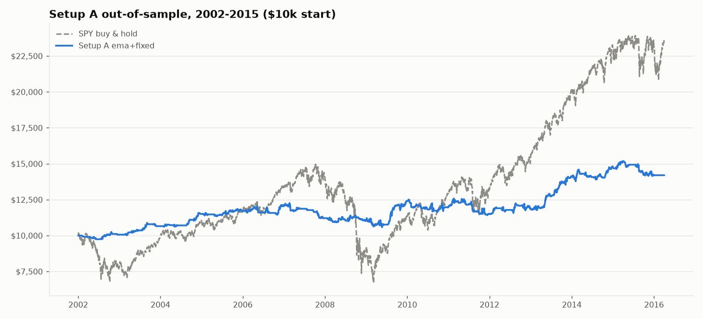

# Out-of-sample test: Setup A (ema+fixed), 2002-2015

Pre-registered in [PREREGISTRATION.md](../PREREGISTRATION.md) (addendum 2026-11-12) before any of this data was downloaded. Configuration unchanged. Yahoo adjusted daily prices for today's S&P 500 names (464 with data in the window) plus SPY. Signals with day 1 in 2002-01-01..2015-12-31; trades opened late in 2015 are allowed to finish by 2016-03-31.

## Data check: do the before/after-close labels still match the volume spike?

If the timing labels were much worse before 2016, day 1 would often be wrong and the test unfair.

| timing_check            | 2002-2015   | 2016-2025   |
|:------------------------|:------------|:------------|
| agrees                  | 65.6%       | 72.5%       |
| disagrees               | 8.9%        | 7.1%        |
| no clear spike          | 22.6%       | 18.3%       |
| no price data           | 0.2%        | 0.7%        |
| non-trading report date | 0.2%        | 0.3%        |
| unknown timing          | 2.4%        | 1.1%        |

## Primary result (signal level, every filled signal)

|   signals |   filled | win rate   |   avg win R |   avg loss R |   expectancy R |   t (weekly clusters) |   SPY over same windows, R |   **market-adjusted R** |   **t market-adj (weekly)** |
|----------:|---------:|:-----------|------------:|-------------:|---------------:|----------------------:|---------------------------:|------------------------:|----------------------------:|
|       542 |      515 | 36%        |        1.61 |        -0.74 |          0.115 |                  1.76 |                     -0.011 |                   0.125 |                        2.47 |

**Pre-registered decision: evidence of a stock-specific edge (market-adjusted > 0 with clustered t >= 2).**

## $10k portfolio (all risk limits) vs SPY

| run                                    |   trades |   expectancy R | CAGR   | max DD   |   Sharpe | avg capital deployed   |
|:---------------------------------------|---------:|---------------:|:-------|:---------|---------:|:-----------------------|
| all signals                            |      425 |          0.146 | +2.5%  | -13.8%   |     0.46 | 17%                    |
| already in S&P 500 on signal date only |      342 |          0.181 | +2.4%  | -9.6%    |     0.5  | 14%                    |

SPY buy & hold, same period: CAGR +6.2%, max DD -55.2%, Sharpe 0.40.

## By year (signal level)

|   entry_date |   trades |   expectancy_R |   market_adj_R |
|-------------:|---------:|---------------:|---------------:|
|         2002 |       11 |         -0.07  |          0.19  |
|         2003 |       15 |          0.589 |          0.195 |
|         2004 |       16 |          0.61  |          0.604 |
|         2005 |       26 |          0.197 |          0.202 |
|         2006 |       32 |          0.075 |          0.06  |
|         2007 |       33 |         -0.184 |          0.036 |
|         2008 |       38 |         -0.005 |          0.15  |
|         2009 |       54 |          0.233 |          0.14  |
|         2010 |       42 |         -0.043 |          0.077 |
|         2011 |       48 |         -0.179 |          0.086 |
|         2012 |       38 |          0.186 |          0.175 |
|         2013 |       47 |          0.6   |          0.295 |
|         2014 |       56 |          0.161 |          0.022 |
|         2015 |       59 |         -0.111 |         -0.014 |

## Signal funnel

reports in period **21,908** → timing known (bmo/amc) **21,383** → price data on day 1 **21,342** → EPS surprise >= 5% **9,175** → gap >= 3% **2,557** → close in upper half **1,366** → volume >= 2x avg **1,155** → liquid (price > $10, ADV > $50m) **566** → above 50 EMA **542** → no market regime filter **542** → next session exists **542**

