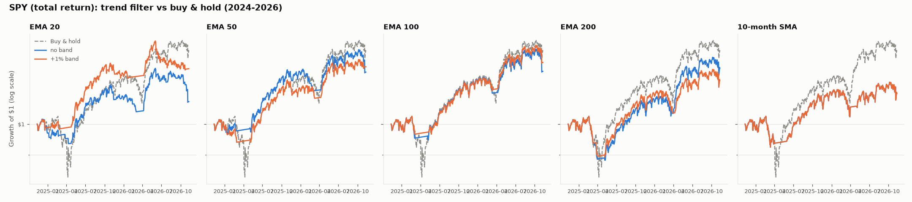
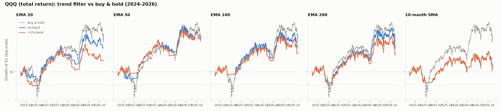
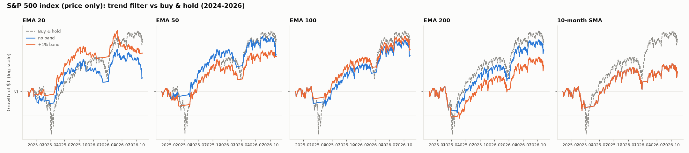

# Setup D: index trend filter, holdout

Hold the index while its close is above the moving average, otherwise hold T-bills (13-week yield). Signals at the close, switches at the next open, 5 bps per switch. No leverage, no shorting. Sharpe uses total returns (rf = 0) for every row, so it's comparable across rows.

## SPY (total return): 2024-11-11 to 2026-11-10

| variant               | CAGR   | volatility   | max DD   |   sharpe |   switches/yr | % invested   |
|:----------------------|:-------|:-------------|:---------|---------:|--------------:|:-------------|
| Buy & hold            | +13.2% | 16.8%        | -18.8%   |     0.82 |           0   | 100%         |
| EMA 20                | +3.9%  | 10.3%        | -11.0%   |     0.43 |          37.6 | 69%          |
| EMA 50                | +9.3%  | 10.8%        | -7.6%    |     0.89 |          18.5 | 78%          |
| EMA 100               | +9.4%  | 11.6%        | -7.8%    |     0.85 |           7.5 | 85%          |
| EMA 200               | +10.0% | 12.7%        | -13.9%   |     0.82 |           8   | 92%          |
| 10-month SMA          | +5.4%  | 12.4%        | -10.0%   |     0.49 |           2   | 87%          |
| EMA 20 +1% band       | +9.9%  | 9.4%         | -9.4%    |     1.06 |          10.5 | 69%          |
| EMA 50 +1% band       | +10.3% | 10.8%        | -7.4%    |     0.97 |           5.5 | 83%          |
| EMA 100 +1% band      | +11.1% | 11.5%        | -6.0%    |     0.98 |           2.5 | 86%          |
| EMA 200 +1% band      | +7.7%  | 12.5%        | -13.1%   |     0.66 |           3   | 92%          |
| 10-month SMA +1% band | +5.4%  | 12.4%        | -10.0%   |     0.49 |           2   | 87%          |

## QQQ (total return): 2024-11-11 to 2026-11-10

| variant               | CAGR   | volatility   | max DD   |   sharpe |   switches/yr | % invested   |
|:----------------------|:-------|:-------------|:---------|---------:|--------------:|:-------------|
| Buy & hold            | +15.2% | 22.6%        | -22.8%   |     0.74 |           0   | 100%         |
| EMA 20                | +10.1% | 14.2%        | -13.5%   |     0.75 |          36.6 | 64%          |
| EMA 50                | +14.3% | 15.0%        | -10.2%   |     0.97 |          16.5 | 73%          |
| EMA 100               | +10.8% | 16.4%        | -12.1%   |     0.71 |          11.5 | 82%          |
| EMA 200               | +10.8% | 18.3%        | -15.4%   |     0.66 |           7.5 | 90%          |
| 10-month SMA          | +2.5%  | 18.5%        | -14.8%   |     0.22 |           2   | 87%          |
| EMA 20 +1% band       | +4.7%  | 13.3%        | -15.7%   |     0.41 |          16.5 | 63%          |
| EMA 50 +1% band       | +14.9% | 15.0%        | -12.3%   |     1.01 |           7.5 | 74%          |
| EMA 100 +1% band      | +7.9%  | 16.1%        | -14.4%   |     0.55 |           6.5 | 81%          |
| EMA 200 +1% band      | +7.8%  | 18.3%        | -14.9%   |     0.5  |           3.5 | 91%          |
| 10-month SMA +1% band | +2.5%  | 18.5%        | -14.8%   |     0.22 |           2   | 87%          |

## S&P 500 index (price only): 2024-11-11 to 2026-11-10

| variant               | CAGR   | volatility   | max DD   |   sharpe |   switches/yr | % invested   |
|:----------------------|:-------|:-------------|:---------|---------:|--------------:|:-------------|
| Buy & hold            | +12.0% | 16.4%        | -18.9%   |     0.77 |           0   | 100%         |
| EMA 20                | +3.0%  | 10.1%        | -12.1%   |     0.35 |          36.6 | 68%          |
| EMA 50                | +8.4%  | 10.7%        | -8.1%    |     0.81 |          20.5 | 77%          |
| EMA 100               | +8.2%  | 11.3%        | -8.3%    |     0.76 |           5.5 | 85%          |
| EMA 200               | +9.5%  | 12.4%        | -11.0%   |     0.8  |           5   | 90%          |
| 10-month SMA          | +4.2%  | 12.4%        | -10.1%   |     0.4  |           2   | 87%          |
| EMA 20 +1% band       | +8.8%  | 9.3%         | -9.7%    |     0.96 |          10.5 | 67%          |
| EMA 50 +1% band       | +8.0%  | 10.7%        | -8.4%    |     0.78 |           6.5 | 83%          |
| EMA 100 +1% band      | +9.6%  | 11.5%        | -5.9%    |     0.87 |           2.5 | 86%          |
| EMA 200 +1% band      | +5.8%  | 12.1%        | -13.1%   |     0.53 |           3   | 90%          |
| 10-month SMA +1% band | +4.2%  | 12.4%        | -10.1%   |     0.4  |           2   | 87%          |

