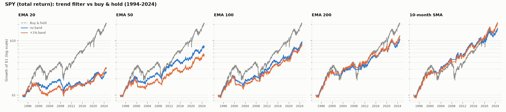
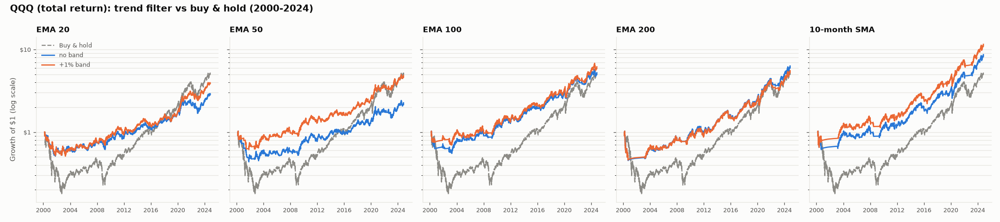
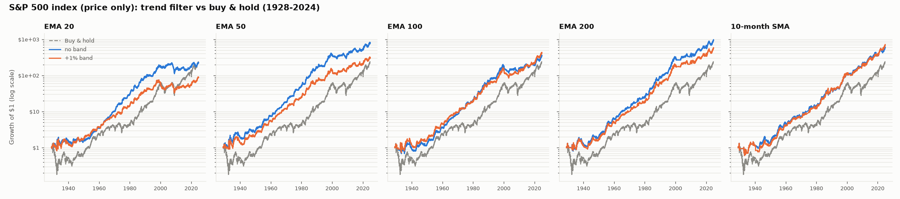

# Setup D: index trend filter, in-sample

Hold the index while its close is above the moving average, otherwise hold T-bills (13-week yield). Signals at the close, switches at the next open, 5 bps per switch. No leverage, no shorting. Sharpe uses total returns (rf = 0) for every row, so it's comparable across rows.

## SPY (total return): 1994-01-29 to 2024-11-10

| variant               | CAGR   | volatility   | max DD   |   sharpe |   switches/yr | % invested   |
|:----------------------|:-------|:-------------|:---------|---------:|--------------:|:-------------|
| Buy & hold            | +10.5% | 18.9%        | -55.2%   |     0.62 |           0   | 100%         |
| EMA 20                | +3.2%  | 11.3%        | -42.8%   |     0.34 |          31.9 | 66%          |
| EMA 50                | +7.0%  | 11.3%        | -28.8%   |     0.66 |          18.6 | 70%          |
| EMA 100               | +7.6%  | 11.8%        | -38.5%   |     0.69 |          12   | 75%          |
| EMA 200               | +8.0%  | 12.4%        | -28.5%   |     0.68 |           7.5 | 78%          |
| 10-month SMA          | +9.6%  | 12.9%        | -24.5%   |     0.78 |           1.4 | 77%          |
| EMA 20 +1% band       | +3.8%  | 11.4%        | -44.7%   |     0.39 |          12.5 | 66%          |
| EMA 50 +1% band       | +5.7%  | 11.4%        | -37.3%   |     0.55 |           7.9 | 71%          |
| EMA 100 +1% band      | +7.3%  | 11.8%        | -44.4%   |     0.66 |           5.4 | 74%          |
| EMA 200 +1% band      | +8.5%  | 12.5%        | -22.0%   |     0.72 |           3.2 | 78%          |
| 10-month SMA +1% band | +10.5% | 13.1%        | -24.5%   |     0.83 |           0.9 | 78%          |

### SPY, recent window only (2016-04-01 to 2024-11-10)

| variant               | CAGR   | volatility   | max DD   |   sharpe |   switches/yr | % invested   |
|:----------------------|:-------|:-------------|:---------|---------:|--------------:|:-------------|
| Buy & hold            | +15.1% | 17.9%        | -33.7%   |     0.87 |           0   | 100%         |
| EMA 20                | +6.1%  | 10.9%        | -26.0%   |     0.61 |          29.5 | 72%          |
| EMA 50                | +8.7%  | 11.3%        | -15.5%   |     0.8  |          17   | 77%          |
| EMA 100               | +11.0% | 11.5%        | -17.0%   |     0.97 |          10.2 | 82%          |
| EMA 200               | +9.1%  | 12.4%        | -28.5%   |     0.77 |           7.7 | 85%          |
| 10-month SMA          | +9.5%  | 12.6%        | -24.5%   |     0.8  |           2   | 84%          |
| EMA 20 +1% band       | +8.5%  | 10.9%        | -19.8%   |     0.81 |          10.9 | 72%          |
| EMA 50 +1% band       | +8.8%  | 11.1%        | -18.7%   |     0.82 |           7.2 | 77%          |
| EMA 100 +1% band      | +11.1% | 11.5%        | -15.6%   |     0.98 |           4.9 | 81%          |
| EMA 200 +1% band      | +10.5% | 12.3%        | -22.0%   |     0.88 |           3.3 | 85%          |
| 10-month SMA +1% band | +13.2% | 12.4%        | -24.5%   |     1.08 |           1.3 | 85%          |

### SPY return during each major sell-off (peak to trough)

|                       | 2000-02 dot-com   | 2007-09 GFC   | 2018 Q4   | 2020 Covid   | 2022 bear   |
|:----------------------|:------------------|:--------------|:----------|:-------------|:------------|
| Buy & hold            | -48%              | -55%          | -19%      | -34%         | -24%        |
| EMA 20                | -21%              | -42%          | -5%       | -4%          | -17%        |
| EMA 50                | -22%              | -19%          | -11%      | -4%          | -10%        |
| EMA 100               | -23%              | -7%           | -10%      | -7%          | -9%         |
| EMA 200               | -21%              | -16%          | -12%      | -19%         | -18%        |
| 10-month SMA          | -5%               | -5%           | -22%      | -12%         | -17%        |
| EMA 20 +1% band       | -28%              | -34%          | -11%      | -4%          | -12%        |
| EMA 50 +1% band       | -24%              | -20%          | -9%       | -4%          | -5%         |
| EMA 100 +1% band      | -22%              | -11%          | -5%       | -7%          | -11%        |
| EMA 200 +1% band      | -14%              | -15%          | -16%      | -19%         | -18%        |
| 10-month SMA +1% band | -14%              | -10%          | -7%       | -12%         | -17%        |

### SPY with 0% on cash (to show how much the T-bill yield matters)

| variant               | CAGR   | volatility   | max DD   |   sharpe |   switches/yr | % invested   |
|:----------------------|:-------|:-------------|:---------|---------:|--------------:|:-------------|
| Buy & hold            | +10.5% | 18.9%        | -55.2%   |     0.62 |           0   | 100%         |
| EMA 20                | +2.4%  | 11.3%        | -43.9%   |     0.27 |          31.9 | 66%          |
| EMA 50                | +6.3%  | 11.3%        | -33.8%   |     0.6  |          18.6 | 70%          |
| EMA 100               | +7.0%  | 11.8%        | -42.8%   |     0.64 |          12   | 75%          |
| EMA 200               | +7.5%  | 12.4%        | -29.9%   |     0.65 |           7.5 | 78%          |
| 10-month SMA          | +9.1%  | 12.9%        | -25.9%   |     0.74 |           1.4 | 77%          |
| EMA 20 +1% band       | +3.0%  | 11.4%        | -51.2%   |     0.32 |          12.5 | 66%          |
| EMA 50 +1% band       | +5.0%  | 11.4%        | -41.9%   |     0.49 |           7.9 | 71%          |
| EMA 100 +1% band      | +6.7%  | 11.8%        | -48.3%   |     0.61 |           5.4 | 74%          |
| EMA 200 +1% band      | +8.0%  | 12.5%        | -23.6%   |     0.68 |           3.2 | 78%          |
| 10-month SMA +1% band | +10.1% | 13.1%        | -25.9%   |     0.8  |           0.9 | 78%          |

## QQQ (total return): 2000-03-10 to 2024-11-10

| variant               | CAGR   | volatility   | max DD   |   sharpe |   switches/yr | % invested   |
|:----------------------|:-------|:-------------|:---------|---------:|--------------:|:-------------|
| Buy & hold            | +7.0%  | 26.7%        | -83.0%   |     0.39 |           0   | 100%         |
| EMA 20                | +4.4%  | 15.3%        | -49.1%   |     0.36 |          32.1 | 62%          |
| EMA 50                | +3.4%  | 15.3%        | -57.6%   |     0.29 |          20.2 | 66%          |
| EMA 100               | +6.9%  | 15.3%        | -46.4%   |     0.52 |          12.6 | 70%          |
| EMA 200               | +7.8%  | 16.4%        | -56.0%   |     0.54 |           6.4 | 74%          |
| 10-month SMA          | +9.1%  | 17.4%        | -40.3%   |     0.59 |           1.9 | 71%          |
| EMA 20 +1% band       | +5.7%  | 15.6%        | -49.0%   |     0.43 |          13.7 | 63%          |
| EMA 50 +1% band       | +6.6%  | 15.1%        | -40.4%   |     0.5  |           9.1 | 66%          |
| EMA 100 +1% band      | +7.7%  | 15.4%        | -32.3%   |     0.56 |           6.3 | 70%          |
| EMA 200 +1% band      | +7.2%  | 16.4%        | -55.3%   |     0.51 |           3.7 | 74%          |
| 10-month SMA +1% band | +10.4% | 17.8%        | -36.5%   |     0.65 |           1.3 | 73%          |

### QQQ, recent window only (2016-04-01 to 2024-11-10)

| variant               | CAGR   | volatility   | max DD   |   sharpe |   switches/yr | % invested   |
|:----------------------|:-------|:-------------|:---------|---------:|--------------:|:-------------|
| Buy & hold            | +20.5% | 22.3%        | -35.1%   |     0.95 |           0   | 100%         |
| EMA 20                | +11.2% | 13.7%        | -31.9%   |     0.85 |          27.4 | 69%          |
| EMA 50                | +9.9%  | 14.4%        | -27.4%   |     0.74 |          17.2 | 75%          |
| EMA 100               | +11.7% | 15.7%        | -21.9%   |     0.79 |          10.9 | 80%          |
| EMA 200               | +17.6% | 16.9%        | -23.2%   |     1.06 |           6   | 84%          |
| 10-month SMA          | +19.4% | 18.2%        | -28.6%   |     1.08 |           1.3 | 82%          |
| EMA 20 +1% band       | +14.0% | 13.9%        | -23.3%   |     1.02 |          11.4 | 70%          |
| EMA 50 +1% band       | +13.1% | 14.3%        | -17.6%   |     0.94 |           8.1 | 75%          |
| EMA 100 +1% band      | +13.2% | 15.9%        | -26.6%   |     0.86 |           6.3 | 81%          |
| EMA 200 +1% band      | +16.3% | 16.8%        | -26.0%   |     0.99 |           3.5 | 84%          |
| 10-month SMA +1% band | +19.6% | 18.6%        | -28.6%   |     1.07 |           1   | 84%          |

## S&P 500 index (price only): 1928-12-30 to 2024-11-10

| variant               | CAGR   | volatility   | max DD   |   sharpe |   switches/yr | % invested   |
|:----------------------|:-------|:-------------|:---------|---------:|--------------:|:-------------|
| Buy & hold            | +5.9%  | 19.0%        | -86.2%   |     0.4  |           0   | 100%         |
| EMA 20                | +5.8%  | 11.7%        | -50.2%   |     0.54 |          29.7 | 61%          |
| EMA 50                | +7.2%  | 11.7%        | -40.1%   |     0.66 |          17.9 | 63%          |
| EMA 100               | +6.3%  | 12.0%        | -46.3%   |     0.58 |          11.9 | 66%          |
| EMA 200               | +7.4%  | 12.0%        | -45.8%   |     0.66 |           7.1 | 69%          |
| 10-month SMA          | +6.9%  | 12.9%        | -53.9%   |     0.58 |           1.5 | 68%          |
| EMA 20 +1% band       | +4.8%  | 11.9%        | -56.8%   |     0.46 |          11   | 60%          |
| EMA 50 +1% band       | +6.2%  | 11.7%        | -44.6%   |     0.57 |           7   | 63%          |
| EMA 100 +1% band      | +6.5%  | 11.9%        | -48.1%   |     0.59 |           5   | 65%          |
| EMA 200 +1% band      | +6.9%  | 11.9%        | -48.9%   |     0.62 |           3   | 69%          |
| 10-month SMA +1% band | +7.1%  | 13.1%        | -53.9%   |     0.59 |           1.1 | 68%          |

## Pre-registered regime filter decision

Rule (fixed before results): first of EMA 200, 10-month SMA that, on SPY in both the full in-sample period and the recent window, cuts max drawdown by >= 1/3, gives up <= 1.5pp CAGR, and has Sharpe >= buy-and-hold.

- EMA 200: full period fail, recent window fail
- 10-month SMA: full period PASS, recent window fail

**Decision: no regime filter.**

