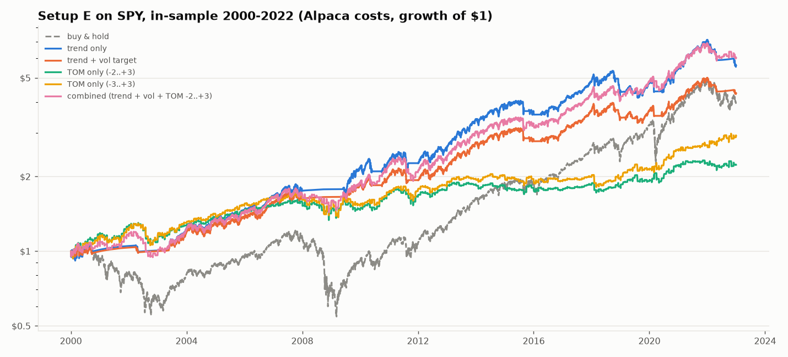
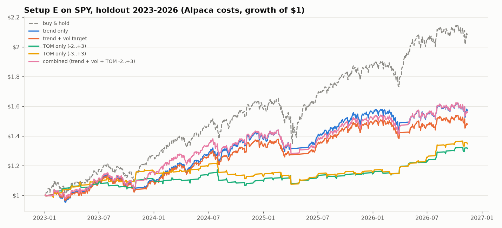
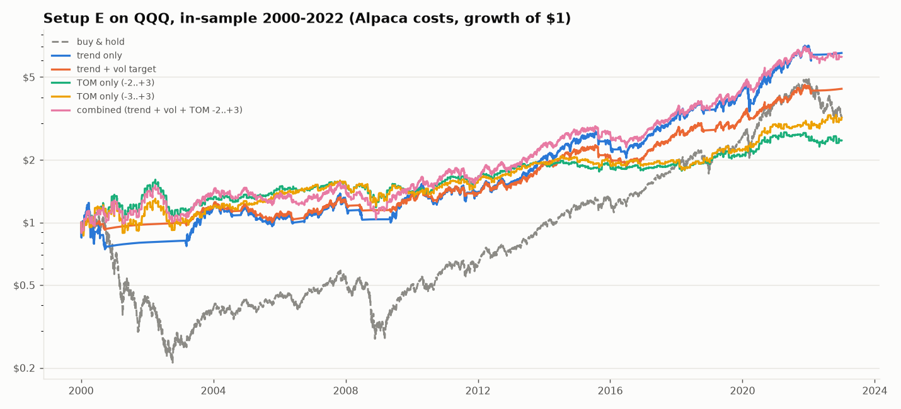
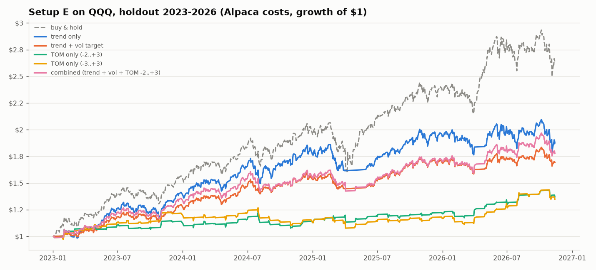

# Research addendum, Setup E: SPY/QQQ trend filter + volatility target + turn-of-the-month tilt

Rules as written in the addendum, no tunable parameters. Code: `signals/setup_e.py`,
`backtest/allocation.py`, `scripts/run_setup_e.py` (evaluation definitions fixed in its docstring
before any results). Results: `results_pre_holdout.csv`, `results_holdout.csv`, `drop_rules.csv`.

## Rules and interpretation choices (fixed in advance)

- **Trend:** at each month-end close, invested if SPY/QQQ closes above its 200-day SMA, else cash
  earning the 3-month T-bill rate (FRED DTB3). Filled at the next open.
- **Vol target:** exposure min(1, 0.12 / sigma20), sigma20 = annualised 20-day realised vol.
  *Choice:* recomputed at every daily close, filled at the next open (the addendum doesn't say how
  often; daily is the direct reading of the formula).
- **TOM:** from the close of trading day -2 before month-end to the close of day +3, hold 1.0x;
  entry and exit at those closes. *Choice:* at the TOM exit close the position returns to the base
  target decided at the *previous* close, so no signal is filled at its own close (rule 4).
- **Costs:** Alpaca 2 bps/side. IG daily-funded index bet: 0.5 pt (S&P 500) / 1.0 pt (Nasdaq-100)
  round trip, plus (fed funds + 3.4%) / 360 per night on the exposure held overnight. Each also x2.
  Cash earns T-bills in every version.
- **Sharpe:** "Sharpe" uses rf = 0; **"excess Sharpe" is over T-bills and is the one used for the
  drop rules** (cash earned 4-5% in 2023-26, so rf = 0 would flatter cash-heavy variants).
- **Periods:** development 2000-2015, validation 2016-2022 (no parameters to re-fit, so simply the
  next out-of-sample block), **holdout 2023-01-01 to 2026-11-13, run once** after the pre-holdout
  results were committed (`be895e6`).

**Caveat on the holdout:** it isn't fully unseen. Setup D (Nov 2026) already showed me how SPY/QQQ
moving-average filters did from Nov 2024 to Nov 2026. E's rules were fixed by the addendum, not by me,
so this couldn't influence them, but the holdout isn't independent of what I'd seen.

## Summary (Alpaca costs): CAGR / max drawdown / excess Sharpe

### SPY

| variant                             | development 2000-2015   | validation 2016-2022   | in-sample 2000-2022   | 2010-2019            | 2020-2026            | holdout 2023-2026    |
|:------------------------------------|:------------------------|:-----------------------|:----------------------|:---------------------|:---------------------|:---------------------|
| buy & hold                          | +4.0% / -55% / 0.21     | +11.6% / -34% / 0.62   | +6.2% / -55% / 0.33   | +13.3% / -19% / 0.88 | +14.6% / -34% / 0.64 | +20.9% / -19% / 1.03 |
| trend only                          | +8.4% / -17% / 0.58     | +6.8% / -22% / 0.50    | +7.8% / -22% / 0.55   | +8.1% / -22% / 0.64  | +9.4% / -24% / 0.53  | +12.4% / -10% / 0.65 |
| trend + vol target                  | +6.7% / -13% / 0.54     | +6.6% / -17% / 0.59    | +6.6% / -17% / 0.55   | +7.0% / -17% / 0.65  | +8.4% / -16% / 0.53  | +10.7% / -10% / 0.56 |
| TOM only (-2..+3)                   | +3.7% / -18% / 0.27     | +3.5% / -9% / 0.33     | +3.6% / -18% / 0.28   | +2.6% / -14% / 0.33  | +6.2% / -9% / 0.42   | +7.4% / -9% / 0.42   |
| TOM only (-3..+3)                   | +4.2% / -20% / 0.30     | +6.4% / -11% / 0.62    | +4.8% / -20% / 0.38   | +3.3% / -12% / 0.40  | +9.1% / -13% / 0.69  | +8.0% / -13% / 0.49  |
| combined (trend + vol + TOM -2..+3) | +7.6% / -21% / 0.53     | +9.6% / -15% / 0.75    | +8.1% / -21% / 0.59   | +9.8% / -20% / 0.83  | +10.0% / -15% / 0.60 | +12.2% / -11% / 0.65 |

### QQQ

| variant                             | development 2000-2015   | validation 2016-2022   | in-sample 2000-2022   | 2010-2019            | 2020-2026            | holdout 2023-2026    |
|:------------------------------------|:------------------------|:-----------------------|:----------------------|:---------------------|:---------------------|:---------------------|
| buy & hold                          | +1.7% / -83% / 0.14     | +14.5% / -35% / 0.65   | +5.3% / -83% / 0.27   | +17.7% / -23% / 1.00 | +18.9% / -35% / 0.70 | +28.4% / -23% / 1.10 |
| trend only                          | +5.7% / -40% / 0.30     | +15.6% / -29% / 0.82   | +8.5% / -40% / 0.46   | +11.8% / -26% / 0.76 | +16.2% / -29% / 0.71 | +17.7% / -15% / 0.75 |
| trend + vol target                  | +4.7% / -20% / 0.32     | +11.5% / -12% / 0.93   | +6.6% / -23% / 0.51   | +9.0% / -23% / 0.75  | +12.7% / -12% / 0.83 | +14.6% / -10% / 0.80 |
| TOM only (-2..+3)                   | +4.0% / -33% / 0.23     | +4.5% / -15% / 0.38    | +4.0% / -33% / 0.26   | +4.0% / -11% / 0.48  | +7.0% / -15% / 0.42  | +8.5% / -12% / 0.45  |
| TOM only (-3..+3)                   | +4.2% / -29% / 0.24     | +7.8% / -10% / 0.62    | +5.2% / -29% / 0.32   | +4.7% / -14% / 0.52  | +9.8% / -15% / 0.60  | +8.1% / -15% / 0.38  |
| combined (trend + vol + TOM -2..+3) | +6.4% / -33% / 0.35     | +13.3% / -17% / 0.88   | +8.3% / -33% / 0.49   | +11.3% / -21% / 0.85 | +14.0% / -17% / 0.76 | +16.1% / -12% / 0.80 |

## Full figures, 2000-2022 (Alpaca)

### SPY

| variant                             | CAGR   | volatility   | max DD   |   Sharpe |   excess Sharpe |   months | win rate (months)   | avg win month   | avg loss month   | time invested   | avg exposure   |   trades/yr |   costs+funding %/yr | top-5% months share of profit   |
|:------------------------------------|:-------|:-------------|:---------|---------:|----------------:|---------:|:--------------------|:----------------|:-----------------|:----------------|:---------------|------------:|---------------------:|:--------------------------------|
| buy & hold                          | +6.2%  | 19.9%        | -55.2%   |     0.4  |            0.33 |      276 | 62%                 | +3.3%           | -3.8%            | 100%            | 100%           |           0 |                 0    | 78%                             |
| trend only                          | +7.8%  | 12.3%        | -22.2%   |     0.68 |            0.55 |      276 | 75%                 | +1.8%           | -2.9%            | 73%             | 73%            |           1 |                 0.02 | 52%                             |
| trend + vol target                  | +6.6%  | 9.7%         | -17.1%   |     0.71 |            0.55 |      276 | 74%                 | +1.6%           | -2.3%            | 73%             | 64%            |          49 |                 0.06 | 47%                             |
| TOM only (-2..+3)                   | +3.6%  | 8.2%         | -18.0%   |     0.47 |            0.28 |      276 | 59%                 | +1.6%           | -1.6%            | 19%             | 19%            |          24 |                 0.48 | 77%                             |
| TOM only (-3..+3)                   | +4.8%  | 9.3%         | -20.0%   |     0.55 |            0.38 |      276 | 60%                 | +1.8%           | -1.7%            | 24%             | 24%            |          24 |                 0.48 | 73%                             |
| combined (trend + vol + TOM -2..+3) | +8.1%  | 11.9%        | -21.1%   |     0.72 |            0.59 |      276 | 64%                 | +2.5%           | -2.5%            | 78%             | 71%            |          50 |                 0.21 | 44%                             |

### QQQ

| variant                             | CAGR   | volatility   | max DD   |   Sharpe |   excess Sharpe |   months | win rate (months)   | avg win month   | avg loss month   | time invested   | avg exposure   |   trades/yr |   costs+funding %/yr | top-5% months share of profit   |
|:------------------------------------|:-------|:-------------|:---------|---------:|----------------:|---------:|:--------------------|:----------------|:-----------------|:----------------|:---------------|------------:|---------------------:|:--------------------------------|
| buy & hold                          | +5.3%  | 27.7%        | -83.0%   |     0.32 |            0.27 |      276 | 58%                 | +5.1%           | -5.4%            | 100%            | 100%           |           0 |                 0    | 111%                            |
| trend only                          | +8.5%  | 18.2%        | -40.2%   |     0.54 |            0.46 |      276 | 70%                 | +2.6%           | -3.6%            | 71%             | 71%            |           2 |                 0.03 | 62%                             |
| trend + vol target                  | +6.6%  | 10.7%        | -22.6%   |     0.66 |            0.51 |      276 | 70%                 | +1.9%           | -2.4%            | 71%             | 54%            |          72 |                 0.09 | 50%                             |
| TOM only (-2..+3)                   | +4.0%  | 12.4%        | -32.9%   |     0.38 |            0.26 |      276 | 58%                 | +2.5%           | -2.5%            | 19%             | 19%            |          24 |                 0.48 | 113%                            |
| TOM only (-3..+3)                   | +5.2%  | 13.7%        | -29.4%   |     0.44 |            0.32 |      276 | 59%                 | +2.6%           | -2.5%            | 24%             | 24%            |          24 |                 0.48 | 97%                             |
| combined (trend + vol + TOM -2..+3) | +8.3%  | 15.6%        | -33.4%   |     0.59 |            0.49 |      276 | 59%                 | +3.5%           | -3.2%            | 76%             | 63%            |          73 |                 0.28 | 63%                             |

## Holdout 2023-2026 (Alpaca)

### SPY

| variant                             | CAGR   | volatility   | max DD   |   Sharpe |   excess Sharpe |   months | win rate (months)   | avg win month   | avg loss month   | time invested   | avg exposure   |   trades/yr |   costs+funding %/yr | top-5% months share of profit   |
|:------------------------------------|:-------|:-------------|:---------|---------:|----------------:|---------:|:--------------------|:----------------|:-----------------|:----------------|:---------------|------------:|---------------------:|:--------------------------------|
| buy & hold                          | +20.9% | 15.0%        | -18.8%   |     1.34 |            1.03 |       47 | 66%                 | +3.6%           | -2.1%            | 100%            | 100%           |           0 |                 0    | 34%                             |
| trend only                          | +12.4% | 12.3%        | -10.0%   |     1.02 |            0.65 |       47 | 66%                 | +2.6%           | -2.1%            | 89%             | 89%            |           2 |                 0.04 | 38%                             |
| trend + vol target                  | +10.7% | 11.1%        | -9.7%    |     0.97 |            0.56 |       47 | 64%                 | +2.4%           | -1.9%            | 89%             | 82%            |          65 |                 0.09 | 42%                             |
| TOM only (-2..+3)                   | +7.4%  | 6.5%         | -9.2%    |     1.12 |            0.42 |       47 | 70%                 | +1.7%           | -1.9%            | 19%             | 19%            |          24 |                 0.49 | 43%                             |
| TOM only (-3..+3)                   | +8.0%  | 7.1%         | -12.6%   |     1.13 |            0.49 |       47 | 66%                 | +1.9%           | -1.8%            | 24%             | 24%            |          24 |                 0.49 | 42%                             |
| combined (trend + vol + TOM -2..+3) | +12.2% | 11.8%        | -11.1%   |     1.04 |            0.65 |       47 | 62%                 | +2.9%           | -2.0%            | 91%             | 85%            |          60 |                 0.14 | 38%                             |

### QQQ

| variant                             | CAGR   | volatility   | max DD   |   Sharpe |   excess Sharpe |   months | win rate (months)   | avg win month   | avg loss month   | time invested   | avg exposure   |   trades/yr |   costs+funding %/yr | top-5% months share of profit   |
|:------------------------------------|:-------|:-------------|:---------|---------:|----------------:|---------:|:--------------------|:----------------|:-----------------|:----------------|:---------------|------------:|---------------------:|:--------------------------------|
| buy & hold                          | +28.4% | 20.5%        | -22.8%   |     1.33 |            1.1  |       47 | 64%                 | +5.1%           | -3.0%            | 100%            | 100%           |           0 |                 0    | 37%                             |
| trend only                          | +17.7% | 18.0%        | -14.8%   |     1    |            0.75 |       47 | 62%                 | +4.1%           | -2.8%            | 92%             | 92%            |           1 |                 0.03 | 45%                             |
| trend + vol target                  | +14.6% | 12.4%        | -9.7%    |     1.17 |            0.8  |       47 | 66%                 | +2.9%           | -2.2%            | 92%             | 66%            |         117 |                 0.12 | 38%                             |
| TOM only (-2..+3)                   | +8.5%  | 8.9%         | -11.9%   |     0.97 |            0.45 |       47 | 60%                 | +2.5%           | -2.0%            | 19%             | 19%            |          24 |                 0.49 | 46%                             |
| TOM only (-3..+3)                   | +8.1%  | 9.8%         | -15.1%   |     0.84 |            0.38 |       47 | 57%                 | +2.8%           | -2.1%            | 24%             | 24%            |          24 |                 0.49 | 47%                             |
| combined (trend + vol + TOM -2..+3) | +16.1% | 14.2%        | -12.1%   |     1.13 |            0.8  |       47 | 66%                 | +3.4%           | -2.7%            | 93%             | 72%            |         113 |                 0.26 | 40%                             |

## IG daily-funded index bet: CAGR / excess Sharpe

| instrument   | variant                             | IG 2000-22   | IG x2 2000-22   | IG 2023-26    | IG x2 2023-26   |   IG costs+funding %/yr |
|:-------------|:------------------------------------|:-------------|:----------------|:--------------|:----------------|------------------------:|
| SPY          | buy & hold                          | +0.9% / 0.07 | -4.1% / -0.19   | +11.5% / 0.50 | +2.9% / -0.04   |                    5.12 |
| SPY          | trend only                          | +3.9% / 0.25 | +0.2% / -0.05   | +4.6% / 0.06  | -2.7% / -0.53   |                    3.68 |
| SPY          | trend + vol target                  | +3.3% / 0.22 | -0.0% / -0.11   | +3.7% / -0.03 | -3.0% / -0.63   |                    3.23 |
| SPY          | TOM only (-2..+3)                   | +2.6% / 0.16 | +1.2% / -0.01   | +6.0% / 0.24  | +4.2% / -0.03   |                    1.41 |
| SPY          | TOM only (-3..+3)                   | +3.6% / 0.26 | +1.9% / 0.08    | +6.3% / 0.26  | +4.1% / -0.04   |                    1.63 |
| SPY          | combined (trend + vol + TOM -2..+3) | +4.4% / 0.29 | +0.5% / -0.03   | +4.8% / 0.07  | -2.2% / -0.52   |                    3.75 |
| QQQ          | buy & hold                          | +0.0% / 0.08 | -5.0% / -0.10   | +18.5% / 0.71 | +9.3% / 0.32    |                    5.12 |
| QQQ          | trend only                          | +4.8% / 0.27 | +1.3% / 0.08    | +9.3% / 0.33  | +1.5% / -0.08   |                    3.47 |
| QQQ          | trend + vol target                  | +3.9% / 0.27 | +1.2% / 0.02    | +8.8% / 0.38  | +3.2% / -0.05   |                    2.65 |
| QQQ          | TOM only (-2..+3)                   | +3.0% / 0.17 | +1.4% / 0.05    | +7.2% / 0.32  | +5.5% / 0.13    |                    1.51 |
| QQQ          | TOM only (-3..+3)                   | +3.9% / 0.23 | +2.1% / 0.11    | +6.4% / 0.22  | +4.3% / 0.01    |                    1.73 |
| QQQ          | combined (trend + vol + TOM -2..+3) | +5.0% / 0.29 | +1.5% / 0.07    | +9.7% / 0.41  | +3.4% / -0.01   |                    3.39 |

Funding is the problem on IG. At fed funds + 3.4%, a fully invested position paid about 5% a year on average over 2000-22 and 8% a year in 2023-26,
and buy-and-hold itself drops from a 2023-26 excess Sharpe of 1.03 (Alpaca, SPY) to 0.50 (IG).

## Drop rules (pre-committed in the addendum)

DSR uses 11 trials (the addendum's running count: Step 0 + 10 E
variants) and the variance of the E variants' daily excess Sharpe, 2000-2022; it's computed on
Alpaca returns and reused for IG. Correlation with Setup A (Step 0, point-in-time, daily, 2010-2026)
is 0.23-0.43 for every variant (buy & hold: SPY 0.43, QQQ 0.40).

| platform   | instrument   | variant                             |   in-sample excess Sharpe |   holdout excess Sharpe |   edge vs B&H at x2 costs |   DSR | top-5% months   |   corr with A | verdict                                                                                  |
|:-----------|:-------------|:------------------------------------|--------------------------:|------------------------:|--------------------------:|------:|:----------------|--------------:|:-----------------------------------------------------------------------------------------|
| Alpaca     | SPY          | trend only                          |                      0.55 |                    0.65 |                      0.22 |  0.95 | 52%             |          0.4  | drop: best 5% of months = 52% of profit                                                  |
| Alpaca     | SPY          | trend + vol target                  |                      0.55 |                    0.56 |                      0.22 |  0.95 | 47%             |          0.43 | PASS                                                                                     |
| Alpaca     | SPY          | TOM only (-2..+3)                   |                      0.28 |                    0.42 |                     -0.11 |  0.65 | 77%             |          0.25 | drop: DSR 0.65; edge gone at x2 costs (-0.11); best 5% of months = 77% of profit         |
| Alpaca     | SPY          | TOM only (-3..+3)                   |                      0.38 |                    0.49 |                      0.01 |  0.81 | 73%             |          0.26 | drop: DSR 0.81; best 5% of months = 73% of profit                                        |
| Alpaca     | SPY          | combined (trend + vol + TOM -2..+3) |                      0.59 |                    0.65 |                      0.24 |  0.97 | 44%             |          0.43 | PASS                                                                                     |
| Alpaca     | QQQ          | trend only                          |                      0.46 |                    0.75 |                      0.18 |  0.89 | 62%             |          0.34 | drop: DSR 0.89; best 5% of months = 62% of profit                                        |
| Alpaca     | QQQ          | trend + vol target                  |                      0.51 |                    0.8  |                      0.24 |  0.93 | 50%             |          0.38 | PASS                                                                                     |
| Alpaca     | QQQ          | TOM only (-2..+3)                   |                      0.26 |                    0.45 |                     -0.05 |  0.62 | 113%            |          0.23 | drop: DSR 0.62; edge gone at x2 costs (-0.05); best 5% of months = 113% of profit        |
| Alpaca     | QQQ          | TOM only (-3..+3)                   |                      0.32 |                    0.38 |                      0.02 |  0.73 | 97%             |          0.24 | drop: DSR 0.73; best 5% of months = 97% of profit                                        |
| Alpaca     | QQQ          | combined (trend + vol + TOM -2..+3) |                      0.49 |                    0.8  |                      0.2  |  0.92 | 63%             |          0.39 | drop: best 5% of months = 63% of profit                                                  |
| IG         | SPY          | trend only                          |                      0.25 |                    0.06 |                      0.14 |  0.95 | 89%             |          0.4  | drop: holdout Sharpe 0.06 (in-sample 0.25); best 5% of months = 89% of profit            |
| IG         | SPY          | trend + vol target                  |                      0.22 |                   -0.03 |                      0.08 |  0.95 | 83%             |          0.43 | drop: holdout Sharpe -0.03 (in-sample 0.22); best 5% of months = 83% of profit           |
| IG         | SPY          | TOM only (-2..+3)                   |                      0.16 |                    0.24 |                      0.18 |  0.65 | 100%            |          0.25 | drop: holdout Sharpe 0.24 (in-sample 0.16); DSR 0.65; best 5% of months = 100% of profit |
| IG         | SPY          | TOM only (-3..+3)                   |                      0.26 |                    0.26 |                      0.27 |  0.81 | 94%             |          0.26 | drop: holdout Sharpe 0.26 (in-sample 0.26); DSR 0.81; best 5% of months = 94% of profit  |
| IG         | SPY          | combined (trend + vol + TOM -2..+3) |                      0.29 |                    0.07 |                      0.16 |  0.97 | 73%             |          0.43 | drop: holdout Sharpe 0.07 (in-sample 0.29); best 5% of months = 73% of profit            |
| IG         | QQQ          | trend only                          |                      0.27 |                    0.33 |                      0.18 |  0.89 | 94%             |          0.34 | drop: DSR 0.89; best 5% of months = 94% of profit                                        |
| IG         | QQQ          | trend + vol target                  |                      0.27 |                    0.38 |                      0.12 |  0.93 | 75%             |          0.38 | drop: best 5% of months = 75% of profit                                                  |
| IG         | QQQ          | TOM only (-2..+3)                   |                      0.17 |                    0.32 |                      0.15 |  0.62 | 143%            |          0.23 | drop: DSR 0.62; best 5% of months = 143% of profit                                       |
| IG         | QQQ          | TOM only (-3..+3)                   |                      0.23 |                    0.22 |                      0.21 |  0.73 | 122%            |          0.24 | drop: holdout Sharpe 0.22 (in-sample 0.23); DSR 0.73; best 5% of months = 122% of profit |
| IG         | QQQ          | combined (trend + vol + TOM -2..+3) |                      0.29 |                    0.41 |                      0.17 |  0.92 | 94%             |          0.39 | drop: best 5% of months = 94% of profit                                                  |

**Survivors: SPY trend + vol target, SPY combined, QQQ trend + vol target, all on Alpaca only.**
Nothing survives on IG.

## Components, plainly

- **Trend (month-end 200-day SMA):** the research expectation holds over 2000-2022: max drawdown
  -22% vs -55% (SPY), -40% vs -83% (QQQ), with better excess Sharpe, because it was out for most of
  2000-02 and 2008. It costs return in recoveries: SPY 2016-22 trend-only excess Sharpe 0.50 vs 0.62
  buy-and-hold, and in 2023-26 it made 12.4% a year vs 20.9%.
- **Vol target:** lowers volatility and drawdown (SPY 2000-22 max DD -17%, QQQ -23%) at about the same
  excess Sharpe as trend alone. It trades about 50-75 times a year, but in small sizes; Alpaca cost is
  under 0.1% a year.
- **TOM:** returns are concentrated in the turn of the month (SPY holds 19% of days and earns 3.6% a
  year in 2000-22, plus T-bills the rest of the time). But on its own it doesn't beat buy-and-hold on
  excess Sharpe, its DSR is 0.62-0.81, and the -2..+3 window loses its edge once costs double. The
  -3..+3 window (a pre-declared second variant) did better in-sample but no better in the holdout.
  Neither TOM window passes.
- **Combined:** the best excess Sharpe in 2000-2022 on SPY (0.59 vs 0.33) and in validation 2016-22
  (0.75 vs 0.62). The TOM tilt adds a little on top of trend + vol on SPY.

## Verdict

**Is the edge real?** The surviving variants are literature rules tested exactly as written (no
searching or tuning), and their DSR is 0.92-0.97. That makes overfitting unlikely; t >= 2 is the
right bar here. But what they reliably deliver is **lower drawdown, not higher return**. They beat
buy-and-hold on risk-adjusted return when there's a long bear market in the sample (2000-02, 2008,
2022) and **lag it badly in strong, fast-recovering markets**. In the 2023-26 holdout every variant
trailed buy-and-hold (SPY combined: 12.2% a year vs 20.9%, excess Sharpe 0.65 vs 1.03), though with
about half the drawdown (-11% vs -19%). So the "edge" is insurance against a deep bear market, and
the 2023-26 result is the premium paid for it, not evidence that it's broken.

**Against Setup A** (Step 0, point-in-time): SPY combined had a Sharpe (rf = 0) of 0.88 in 2010-19 and
0.83 in 2020-26, vs A's 0.71 and 0.41. Its correlation with A is low (0.43) and it holds ~85% of
capital rather than ~30%. On every measure here, E beats A.

**Platform: Alpaca (automated), not IG.** It needs month-end checks, daily vol-target rebalancing
(small orders, about 50 a year) and orders at specific closes for the TOM windows. That's easy to
automate and awkward to do by hand. IG's funding (fed funds + 3.4% on the full notional every night)
turns the 2023-26 holdout excess Sharpe for SPY to roughly zero.

If you want one variant, **SPY combined (trend + vol target + TOM -2..+3) on Alpaca** has the strongest
case (best in-sample and validation excess Sharpe, DSR 0.97, passes every rule). But paper-trading any
new setup waits for your decision, as the addendum says.

## Variants counted

10 (5 rules x SPY and QQQ). Addendum running total: **11**. See [VARIANT_LEDGER.md](../VARIANT_LEDGER.md).
